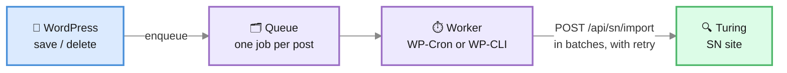

The WordPress Connector is a **PHP plugin installed inside WordPress**, `viglet-dumont`. It
sends your content to a Viglet Turing Semantic Navigation (SN) site and answers your
site's search from it.

:::note[This is a WordPress plugin, not a Java plugin]
Unlike the AEM and Web Crawler connectors (Java JARs loaded into `dumont-connector.jar`),
the WordPress connector runs entirely inside WordPress and talks to Turing over HTTP. No
Dumont process is needed.
:::

Requires **WordPress 6.6** and **PHP 8.1** or later.

---

## How it works



- **Saving a post never calls Turing.** Publishing, updating, unpublishing, trashing or
  deleting a post only queues one job for it; saving again replaces that job, so the last
  save wins.
- **A worker sends the queue** in batches through WP-Cron, or through
  `wp dumont queue run` on hosts that disable WP-Cron. When Turing is unreachable, a job
  backs off (1 minute, doubling, up to an hour). After 8 failed attempts it waits for a
  replay. A post Turing refuses is retried on its own, so one bad post does not block the
  rest of its batch.
- **Each post records its state**: when it was last indexed, its last error and its
  failed attempts. The post lists and the block editor show it (see [Admin](#admin)).

---

## Install

**From wp-admin**: download `viglet-dumont-<version>.zip` from the
[Dumont releases](https://github.com/openviglet/dumont/releases) (tags
`wordpress-v<version>`) and upload it under **Plugins → Add New → Upload Plugin**.

**With Composer**, for a site built in CI or running with `DISALLOW_FILE_MODS`: declare the
release zip as a package, and `composer/installers` puts it in the plugins directory.

```json
{
    "repositories": [
        {
            "type": "package",
            "package": {
                "name": "viglet/dumont-wordpress",
                "version": "2.0.0",
                "type": "wordpress-plugin",
                "dist": {
                    "type": "zip",
                    "url": "https://github.com/openviglet/dumont/releases/download/wordpress-v2.0.0/viglet-dumont-2.0.0.zip"
                },
                "require": { "composer/installers": "^2.0" }
            }
        }
    ],
    "require": { "viglet/dumont-wordpress": "2.0.0" }
}
```

**With WP-CLI**: `wp plugin install <zip URL> --activate`.

Then open **Viglet Dumont → Setup**.

---

## Connect to Turing


**Viglet Dumont → Setup** takes the connection, then **Save and test the connection** checks
it one step at a time and stops at the first failure, naming it:

| Step | Fails when |
|---|---|
| Address | The URL is not a full `http://` or `https://` address |
| Network | The host does not resolve (DNS), the certificate is rejected (TLS), nothing answers in time, or nothing listens on that port |
| Turing | The server answers, but not with Turing's discovery document (wrong URL, or a proxy in the way) |
| API key | No key is set, or Turing refuses it (wrong, expired, or its user cannot manage SN sites) |
| SN site | No SN site has that name yet; the page offers **Create the SN site** |

Once every step passes, **Index everything now** runs the first index with a progress bar.

| Setting | Meaning |
|---|---|
| **Turing URL** | Turing as this server reaches it, e.g. `https://search.example.org` |
| **API key** | A Turing API token (Turing console → API Tokens). It is never shown again after saving |
| **SN site** | The Semantic Navigation site this WordPress publishes to and searches |
| **Locale** | The language the content is indexed in, e.g. `pt_BR` |
| **Site key** | Starts every document id; see [Several sites, one SN site](#several-sites-one-sn-site) |

In [WordPress Playground](https://wordpress.org/playground/), WordPress runs in the
visitor's browser and so do its requests to Turing: the blueprint needs
`features.networking` on, and Turing has to be on a public address. A public Turing is
reached directly when its `turing.allowedOrigins` includes `https://playground.wordpress.net`,
and through Playground's own proxy when it does not. One on a private address, such as
`http://localhost:2700`, cannot be reached from there at all, and the connection check says
so at the **Network** step rather than reporting an HTTP error.

### From the environment

A container deploy can set the connection with no wp-admin step. Each of these is read
from a `wp-config.php` constant or, failing that, an environment variable of the same name.
A value set either way wins over the settings page, shows there read-only, and is
**never written to the database**, so the API key stays out of database backups.

| Name | Setting |
|---|---|
| `VIGLET_DUMONT_TURING_URL` | Turing URL, as this server reaches it |
| `VIGLET_DUMONT_TURING_SITE` | SN site |
| `VIGLET_DUMONT_TURING_API_KEY` | API key |
| `VIGLET_DUMONT_TURING_LOCALE` | Locale |
| `VIGLET_DUMONT_SITE_KEY` | Site key |
| `VIGLET_DUMONT_PUBLIC_URL` | Turing as visitors' browsers reach it, when that differs |

`wp dumont status` prints where each value came from.

### Demo mode

`VIGLET_DUMONT_DEMO=1`, as a constant or an environment variable, is for a site whose
wp-admin belongs to whoever opens it, such as a demo in WordPress Playground. The site then
holds no API key and never writes to Turing: saving a post queues nothing, the indexing
buttons say demo mode is on, and **Search tuning** and **Search insights** are hidden,
because their Turing endpoints need a key. Search, chat, the copilot and answers keep working
from the visitors' browsers against a **PUBLIC** SN site whose index is built elsewhere, and
the connection check confirms that site with a search sent without a key. It cannot be
turned off from wp-admin.

---

## What gets indexed

Every post sends a fixed document: `id`, `title`, `text` (the rendered body without
markup, shortcodes or hidden UI text), `abstract`, `url`, `type`, `author`,
`publication_date`, `modification_date`, `site`, `image`, `site_key`, `source_apps`, plus
`categories` / `section` and `tags` when those options are on. Approved comments and named
custom fields can be added on the Settings page.

### Fields and facets


**Viglet Dumont → Fields** maps, per post type, what else becomes its own Turing field:

- **Source**: a taxonomy, a meta key the posts actually carry, a post field (excerpt,
  slug, menu order, parent) or the featured image URL.
- **Type**: `STRING`, `TEXT`, `INT`, `LONG`, `FLOAT`, `DOUBLE`, `DATE` or `BOOL`. A value
  that does not convert is left out, never guessed. Dates are read as `Ymd` (ACF), a Unix
  timestamp, or any date `strtotime` reads.
- **Multiple**, **Facet** with its label, and a **Weight** (1 to 100) for ranking.
- **Ranges**, on a `DATE` or number field: a range facet as well, provisioned as a Turing
  custom facet named `<field>_range`. A date gets a fixed set (upcoming, last 7 days, last
  30 days, this year, before this year). A number lists its own ranges, each with a label
  and a **From** and **To**; an empty bound is an open end, and an empty label is written
  from the bounds ("20 – 50", "Up to 20", "50 or more").
- **Leave this type out of search** switches a whole post type off.

**In Turing** says where each field stands: *In Turing*, *Added on the next save*, or
*Conflict* when Turing already holds the field with another type. **Preview document**
shows the JSON the newest post of the type sends. **Save and send to Turing** stores the
mapping and provisions the fields through Turing's manifest API, so facets need no console
step. Run a reindex afterwards so existing posts carry the new fields.

With nothing configured, every public custom taxonomy is mapped as a facet.

**WooCommerce.** With WooCommerce active and `product` among the indexed types, a product
offers its shop fields as sources: **Product: Price**, **Regular price**, **Sale price**,
**Stock status**, **SKU** and **Average rating**. With nothing configured a product sends
its price, its stock as a **Stock** facet (in the shop's words, "In stock"), its product
categories and tags, and each global attribute (`pa_color`, ...) as a facet. Turn on
**Ranges** for the price to filter by "Up to 50", "50 – 100" and so on. A product whose
stock changes from an order is sent again, although no post was saved.

In the **Turing search** block a product's result shows its price in the shop's currency
(the regular price struck through when it is on sale) and an **Add to cart** button. It
adds one through WooCommerce's Store API without leaving the page, and says whether it
worked, with WooCommerce's reason when it did not (out of stock, say).

The same mapping is readable and writable as JSON at `viglet-dumont/v1/mapping`. A theme
can map in code with the `viglet_dumont_mapping` filter, and change a document just before
it is sent with `viglet_dumont_document`.

### Excluding content

A post is left out when its type is off, when its ID is in **Exclude Posts/Pages**
(Settings), or when **Exclude from search** is on in its editor panel
(`_viglet_dumont_exclude` meta).

---

## Several sites, one SN site

Document ids are `<site key>:post:<post ID>`, and every document carries a `site_key`
field, provisioned as a facet. Several WordPress sites (or the blogs of a multisite
network) can therefore publish into one SN site for a unified search, without replacing
each other's documents. The key defaults to the site's host and path
(`example.org-projetos`); set it in Setup or with `VIGLET_DUMONT_SITE_KEY`.

**Delete All** and `wp dumont sweep` remove only this key's documents.

:::tip[Upgrading from an earlier version]
Ids used to be `wp-<ID>`. Run **Index All** (or `wp dumont reindex`) once after upgrading:
it indexes every post under its new id and removes the copy under the old one.
:::

---

## WP-CLI

| Command | What it does |
|---|---|
| `wp dumont status` | Connection, SN site, site key, published versus indexed documents per type, the queue, and where each setting came from |
| `wp dumont index [--type=<type>] [--ids=<ids>] [--since=<date>]` | Indexes now, synchronously, with a progress bar; exits non-zero when a batch fails. `--ids` also removes the listed posts that are not published |
| `wp dumont reindex` | Provisions the fields, indexes every published post, then sweeps |
| `wp dumont sweep [--dry-run]` | Removes from Turing this site key's documents that WordPress no longer publishes, e.g. posts deleted while the plugin was off |
| `wp dumont queue run [--retry-failed]` | Sends the queue now, ignoring backoff, and names each post that failed |
| `wp dumont queue status` | Lists the waiting and failed jobs with their last error |

The same operations answer over REST under `viglet-dumont/v1/`: `status`, `index`,
`sweep`, `queue/run` and `queue/retry`.

---

## Admin

| Screen | What it is for |
|---|---|
| **Setup** | The connection and its step-by-step test, the SN site, the first index |
| **Fields** | The per-type field mapping, its state in Turing, a document preview |
| **Health** | Published versus indexed per type, the queue, its last run, the last 50 events |
| **Settings** | Post types, categories, tags, comments, custom fields, exclusions, batch size, search |


**Health** has **Retry failed** and **Send queue now**, and lists every send, removal,
provisioning and sweep with its error when it failed.

The post lists gain a **Search** column: *Indexed 2 mins ago*, *Queued*, *Failed* (the
error shows on hover), *Excluded* or *Not published*. The block editor has a **Search**
panel with the same state, **Exclude from search** and **Reindex now**.

The same panel's **Assist** section helps while writing, and changes nothing on its own:

- **Find related posts** lists what may already cover the post (*Already covered?*) and
  posts to link to (*Link ideas*), from Turing's similar-documents and duplicate searches.
  A draft not yet indexed is compared by its title. **Add a link** puts a paragraph with
  the link after the selected block.
- **Draft an excerpt** asks Turing's language model, from WordPress's server with the
  stored API key, for a one- or two-sentence excerpt of the saved post, in the site's
  language. **Use this excerpt** fills the excerpt field; the post changes only when you
  save it. **Draft another** asks again. Turing needs a default language model for it.


**Viglet Dumont → Insights** shows what visitors searched for in the last 24 hours, 7 days,
30 days or all time, read from Turing's search metrics with the stored API key: the top
searches with their clicks and click-through, the searches that found nothing (with when
they were last made), and the ones that found results nobody opened. Each of those last
two offers **Write about this**, a new draft titled with the search, and a search that
found nothing also offers **Add a synonym**, which opens **Tuning** with it typed in.
Searches the block makes while the visitor is still typing are left out. The dashboard's
**Site search this week** widget shows the week's five top searches and five that found
nothing.

The admin ships in English and Brazilian Portuguese.

---

## Search

**Replace WordPress search with Turing** (Settings → Search) is off on a fresh install.
With it on, the results page is the **theme's own**: Turing answers WordPress's main search
query and the theme's search template renders the results, so a block theme keeps its
header, footer and styles. Only this site key's documents come back. If Turing does not
answer, WordPress searches its database as before. The plugin's older results page (with
facets, for classic themes) remains available as **Results page → The plugin's results
page**.

### The Turing search block


The **Turing search** block is a complete search UI for any page. It has a box with
suggestions, "did you mean", the mapped facets, results and pages. It is built with the
Interactivity API on Turing's JS SDK and takes its colours and type from the theme. It
reads `?q=` (or `?s=`), so a page holding it can serve as the site's search page.

With **Suggest the filters a sentence names** on, a search that reads as a sentence ("posts
about php from last year") also asks Turing's natural-language filters which filters it
names. The ones Turing checked against the site, on a mapped facet or on the post type or
publication date, show as chips under the box; a click applies one and takes the words it
was read from out of the query. Nothing is applied without a click. Each sentence is an LLM
call, and with no language model in Turing nothing is offered.

With **Apply them instead of suggesting** on as well, the filters are applied straight away
and a line under the box says what was read: "Understood: Color: Red, Price: ≤ 200", with
**Undo** to put the search back as it was typed. On a WooCommerce shop a price the sentence
names ("under $400", "até R$ 400", "entre 100 e 300 reais", "over $50") is read by the block
itself and filters the shop's price field, so it works even with no language model in
Turing. Only an amount marked as money counts: "under 2 kg" is left alone. A size works
the same way ("size M", "tamanho 42") on a facet whose field or name says size, and only
when that value is one the site's products have: "size XXXL" sets nothing.

A site with its own search blocks turns the block off:

```php
add_filter( 'viglet_dumont_register_blocks', '__return_false' );
```

### The Ask the catalog block

The **Ask the catalog** block is a conversation with Turing's catalog copilot. A visitor
asks in plain words, and the answer comes from this site's content and cites the items it
used. On a WooCommerce shop each cited product shows the shop's price and an **Add to cart**
button; the copilot never puts anything in the cart by itself. The block appears only when
Turing has a language model for the copilot.

**Build my kit.** With **Offer Build my kit** on (the default, in the block's settings), the
block has a second mode, **Plan a kit**. The visitor describes a plan ("two days crossing the
mountains in July, first time") and Turing answers with the needs the plan implies, each
with the products it found for it and a one-line reason drawn from the product's own
attributes:

- Prices come from WooCommerce, and so does stock: a product the shop cannot sell is marked
  **Out of stock** and left out of the cart, whatever the index says.
- A need the catalog has nothing for is named ("Nothing in the catalog yet for: shelter")
  rather than filled with something unrelated.
- Journal posts that cover the plan are listed as **Guides for this plan**.
- The visitor can untick any product, then **Add N products to the cart** puts the rest in
  the cart at once. The confirmation shows the cart's total as WooCommerce computes it.

The kit needs a Turing that has the kit call (`POST /api/sn/{site}/copilot/kit`), which
2026.3.6 does not, and the **Stock** field mapped, which a WooCommerce site has by default.

### Building your own search on the SDK

The plugin registers [`@viglet/turing-sdk`](https://www.npmjs.com/package/@viglet/turing-sdk)
as WordPress script modules, so a theme imports it instead of bundling a copy:

- `@viglet/turing-sdk`: the SDK as published;
- `viglet-dumont/search`: the SDK already configured for this site, with searches filtered
  to its site key.

```js
// A theme module registered with 'viglet-dumont/search' as a dependency.
import { createSiteSearch, createSiteAutoComplete, config } from 'viglet-dumont/search';

const search = createSiteSearch();      // search-only; { controller: { chat: true } } adds answers
search.subscribe( ( state ) => render( state ) );
await search.searchQuery( 'workshop' );
```

The configuration it reads is public and holds no key: Turing's public URL, the SN site,
the locale, the site key and the mapped facets. PHP reads it with
`viglet_dumont_public_config()`, and anything else with
`GET /wp-json/viglet-dumont/v1/public-config`.

:::caution[CORS]
Browser search calls Turing directly, so Turing must allow the WordPress site's origin:
add it to Turing's allowed origins (`TURING_ALLOWEDORIGINS` in a container). When browsers
reach Turing at another address than the server does, set `VIGLET_DUMONT_PUBLIC_URL`.
:::

---

## Try it locally

The plugin's source, [`wordpress/`](https://github.com/openviglet/dumont/tree/2026.3/wordpress)
in the Dumont repository, has a Docker stack for trying it end to end. `run-docker.cmd`
starts WordPress, MariaDB, a WP-Cron runner and a local Turing, creates the SN site, gives
the plugin an API key, and builds the admin screens. WordPress is then at
`http://localhost:8080` and Turing at `http://localhost:2700`.

`run-docker.cmd demo` also starts the demo store, Tarnfell: a WooCommerce shop with its own
catalog, buying guides and SN site at `http://localhost:38082`. Its `/showcase/` page holds
every Turing block, and `?tour=1` on any of its pages marks each feature with its chapter in
the [shopper's story](https://github.com/openviglet/dumont/blob/2026.3/wordpress/demo/story.md)
that the [WordPress page](https://openviglet.github.io/dumont/wordpress/) walks through. Set `OPENAI_API_KEY` before
starting it to turn on the answers, the catalog copilot and the Site assistant; without it
they stay hidden. `DEMO_LOCALE=pt_BR` seeds the store in Portuguese. The demo is started by
the Windows launcher only for now: `run-docker.sh` has no `demo` command yet.
