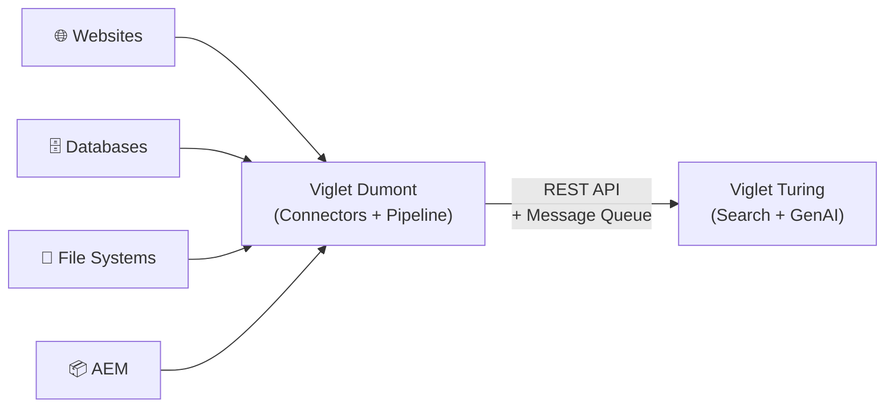

**Viglet Dumont** is an open-source data extraction platform. It connects your content (wherever it lives) to [Viglet Turing](https://turing.viglet.org/) for indexing and search.

Think of Viglet Dumont as the bridge between your content sources and the search engine. It crawls websites, queries databases, scans file systems and reads AEM repositories, then delivers every document to Viglet Turing through a reliable, asynchronous pipeline.

---

## What can you do with Viglet Dumont?

### Crawl websites

Point the **Web Crawler** at a starting URL and let it discover and extract content from your entire site: pages, articles, documentation. It handles authentication, URL filtering, locale detection, and incremental updates.

### Index databases

The **Database Connector** runs any SQL query against Oracle, PostgreSQL, MariaDB, MySQL, or any JDBC-compatible database and turns each row into a searchable document. Complex joins, custom transformations, and batch processing are all supported.

### Scan file systems

The **FileSystem Connector** walks a directory tree, extracts text from PDFs, Word documents, spreadsheets, presentations, and images (via OCR), and indexes everything with full metadata: file size, extension, modification date.

### Connect to AEM

The **AEM Connector** indexes content from Adobe Experience Manager author and publish instances, supporting content fragments, delta tracking, locale mapping, and custom extension points for your specific AEM setup.

### WordPress: part of Viglet Turing

WordPress is not a Viglet Dumont source. The WordPress and WooCommerce plugin is part of **Viglet Turing**: it runs inside WordPress and sends content straight to Viglet Turing, without Viglet Dumont. See [Viglet Turing for WordPress](https://turing.viglet.org/docs/integrations/wordpress/).

### Send to Viglet Turing, Apache Solr or Elasticsearch

Beyond Viglet Turing, Viglet Dumont can deliver content directly to **Apache Solr** or **Elasticsearch** via pluggable indexing adapters, no Viglet Turing required.

---

## How it works at a glance

Content flows from its original source through Viglet Dumont connectors, into an internal message queue for reliable processing, and out to the search engine, where it becomes immediately searchable.

---

## Key concepts

These are the main building blocks you will work with in Viglet Dumont. You do not need to understand all of them before getting started: come back to each one as you need it.

| Concept | What it is | Learn more |
|---|---|---|
| **Connector** | A component that extracts content from a specific source type (web, database, files, AEM, JSON APIs) | [Connectors](/docs/connectors/overview/) |
| **Indexing Plugin** | The output adapter that delivers documents to a search engine, Viglet Turing (default), Apache Solr, or Elasticsearch | [Indexing Plugins](/docs/indexing-plugins/) |
| **Job Item** | A single document being processed through the pipeline, with fields, metadata, and an action (index, de-index, update) | [Core Concepts](/docs/getting-started/core-concepts/) |
| **Batch Processor** | Groups individual job items into configurable batches (default: 50) for efficient queue delivery | [Core Concepts](/docs/getting-started/core-concepts/) |
| **Message Queue** | Apache Artemis (embedded): decouples connector extraction from indexing delivery for reliability and throughput | [Architecture](/docs/architecture/) |
| **Processing Strategy** | Priority-based rules that determine how each document is handled, index, re-index, de-index, ignore, or skip unchanged | [Core Concepts](/docs/getting-started/core-concepts/) |
| **Indexing Rules** | Regex-based filters that skip documents matching specific attribute patterns before they reach the queue | [Core Concepts](/docs/getting-started/core-concepts/) |

---

## Where to go next

Not sure where to start? Here is a suggested path depending on what you want to do:

**I want to understand how Viglet Dumont works**
→ Read [Core Concepts](/docs/getting-started/core-concepts/) first, then [Architecture](/docs/architecture/).

**I want to install Viglet Dumont**
→ Go to the [Installation Guide](/docs/installation-guide/).

**I want to crawl a website**
→ Go to [Web Crawler Connector](/docs/connectors/web-crawler/).

**I want to index a database**
→ Go to [Database Connector](/docs/connectors/database/).

**I want to index files from a directory**
→ Go to [FileSystem Connector](/docs/connectors/filesystem/).

**I want to connect AEM to Viglet Turing**
→ Go to [AEM Connector](/docs/connectors/aem/).

**I want to index WordPress content**
→ The WordPress plugin is part of Viglet Turing: go to [Viglet Turing for WordPress](https://turing.viglet.org/docs/integrations/wordpress/).

**I want to send content to Solr or Elasticsearch directly**
→ Go to [Indexing Plugins](/docs/indexing-plugins/).

**I want to contribute or build from source**
→ Go to the [Developer Guide](/docs/developer-guide/).

---

